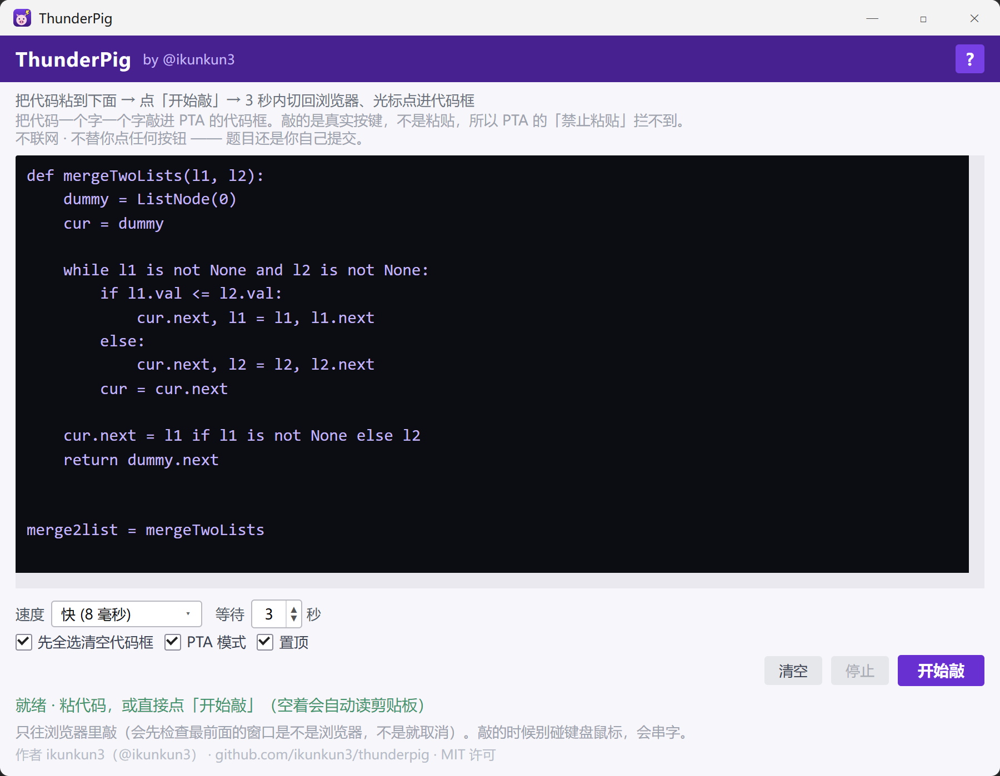

# PTA 逐字输入（哇嘞哇嘞大雷猪）

> 把代码交给它，它**一个字一个字敲进** PTA 的代码框。
> 敲的是真实键盘事件，不是粘贴 —— 所以 PTA 的「禁止粘贴」拦不到。



**[⬇ 下载 exe](https://github.com/ikunkun3/pta-typer/releases/latest/download/pta-typer-v1.3.1.exe)** · 单文件 · 免安装 · 不联网

（[全部文件](https://github.com/ikunkun3/pta-typer/releases/latest) / 想要书签和油猴脚本就下 zip 包）

---

## 先说清楚它是什么、不是什么

> **这不是自动搜题、自动作答软件。**
>
> 它不搜题、不查答案、不认识题目、也不知道答案对不对。它只做一件事：把你复制给它的那段文字，一个字符一个字符地打到当前光标所在的输入框里，跟有人坐在那里用键盘打出来一模一样。
>
> **答案从哪来、写什么内容、对不对，全是你自己的事。它只负责「搬运」，不负责「想」。**

具体到代码层面，它：

- **不点保存、不点测试、不点提交** —— 源码里一行点击提交按钮的代码都没有
- **不联网** —— 没有任何对外请求，没有更新检查，没有统计
- **不读剪贴板**（除一处：你框子空着时点「开始敲」，它读一次剪贴板省得你手动粘）
- **不读文件、不写注册表** —— 唯一的落盘是 `%LOCALAPPDATA%\哇嘞哇嘞大雷猪\cfg.json`，存你的速度和窗口位置

---

## 为什么需要它

PTA（拼题 A / pintia.cn）的代码框**禁止粘贴**，而且拦得很彻底。实测：

```
往代码框派一个带 clipboardData 的真实 paste 事件
  → event.defaultPrevented === true
  → 代码框内容 47 字符，一字未变
```

而从别处（编辑器 / 笔记 / 聊天记录）把代码搬过来时，按 Ctrl+V 会在第一步就被拦死。手动一行行敲 —— 一百多行、每行缩进 4 个空格、还要担心中文标点 —— 打错一个字符就要重新调试。

这个工具绕开的不是「防作弊」，是**「防粘贴这个输入方式」**：它发的是键盘事件（Windows `SendInput`），那本来就不是粘贴。

---

## 怎么用（四步）

### 1. 打开 PTA 那道题

浏览器里打开一道**函数题 / 编程题**，进到能看到黑色代码框的那一页。

> 怎么判断？**右半边有一整块黑底、里面是等宽字体的代码框**，就是这页。单选题、填空题没有这个框，工具也用不上。

### 2. 双击 exe

Windows 第一次可能弹「Windows 已保护你的电脑」—— 因为它要模拟键盘，被杀毒软件当成可疑程序了。

点「**更多信息**」→「**仍要运行**」即可。

### 3. 把代码弄进黑框

两种都行：

- 在别处 `Ctrl+C` 复制代码 → 回到 exe 点「开始敲」（**黑框空着时它会自己去读剪贴板**）
- 或者直接 `Ctrl+V` 粘进 exe 的黑框

代码原样保留缩进、空行、制表符，不需要做任何格式处理。

### 4. 点「开始敲」，然后手离开键鼠

点下去之后它会**倒数 3 秒**（右下角「等待」可以改成 0～60 秒）。趁这几秒：

1. 切回浏览器
2. **用鼠标点一下那个黑色代码框**，让光标在里面闪
3. 手离开键盘鼠标

倒计时结束，它会一个字一个字打进去。**这期间不要碰键盘鼠标** —— 你按的键会一起进代码框，字就串了。

打完看一眼面板底部：绿字说明成功，红字说明有问题（见下面的排错表）。

然后**自己**点「测试用例」，**自己**点「提交本题作答」。提交这一步它绝不代劳。

---

## 界面说明

| 控件 | 作用 |
|---|---|
| **大黑框** | 你的代码放这儿。可以直接粘，也可以空着让它读剪贴板 |
| **速度** | 极快（0 毫秒）/ 快（8 毫秒）/ 正常（30 毫秒）/ 慢（100 毫秒）。填「极快」几乎瞬间完成，「慢」能看清一个一个字打进去 |
| **等待** | 点「开始敲」后倒数几秒再动手，默认 3 秒。给你切窗口的时间 |
| **先全选清空代码框** | 敲之前先发 `Ctrl+A` → `Delete` 清空 PTA 的框。不勾就是追加到现有内容后面 |
| **PTA 模式** | 默认勾着。利用 PTA 代码框自己补的缩进，少敲一些空格（见下一节） |
| **置顶** | 默认开着，窗口浮在浏览器上面。`Ctrl+T` 也能切换 |
| **清空** | 只清本程序的黑框，不碰浏览器里的 |
| **开始敲** | 开始。也可以按 `Ctrl+Enter` |
| **`?`** | 重新看一遍四步说明 |
| **状态行** | 绿=正常，橙=进行中，红=出问题了 |

窗口位置、速度、等待秒数、各个勾选状态都会记住，下次打开还是上次的样子。

---

## 「PTA 模式」是怎么回事

PTA 的代码框是 CodeMirror 6，它有两个自动行为：

1. **按回车后自己补缩进** —— 上一行是 `def f():` 就补 4 格，上一行是 `    x = 1` 就还补 4 格（它**不反缩进**）
2. **敲左括号自动补右括号** —— 敲 `(` 变 `()`，敲 `[` 变 `[]`

如果不处理这两件事，敲进去的代码就会「缩进翻倍、括号两对」。

**PTA 模式的核心原则：不赌，只对账。**

按下回车之后，它先看网页实际补了几格，再跟自己的预测比：

- 一样 → 就用网页补的，那些空格不再重复敲
- 不一样 → 发 `Shift+Home` + `Delete` 把网页补的抹掉，照你原文的缩进重敲

两条路写出来的代码**一模一样**，区别只是省不省按键。所以「规则测错了」也不会变成「代码写错了」。

敲完左括号立刻按一下 `Delete`，正好撤掉网页自动补的右括号（光标那时在括号中间）。

**什么时候要把它关掉**：换到不是 PTA 的地方（记事本、VS Code、别的在线编辑器）时。那些环境不会自动缩进，开着反而会多删空格。关掉之后就是老老实实照原文一个字符一个字符敲。

---

## 出问题了怎么查

| 你看到的 | 原因 | 怎么办 |
|---|---|---|
| 点了「开始敲」，浏览器里一个字都没出现 | 光标不在代码框里 | 切回浏览器，**用鼠标点一下**代码框，让它有闪烁的光标，再重来 |
| 状态行红字「…不是浏览器」 | 最前面的窗口不是浏览器，保险拦住了 | 这是设计如此 —— 一个字符都没发出去。切到浏览器再点 |
| 字打进去了但位置不对 / 顺序乱了 | 敲的时候碰了键鼠 | 别动键鼠，重来一次 |
| 缩进变成双倍，嵌套越深偏得越多 | 关掉了 PTA 模式，或者对方不是 PTA 的编辑器 | 把「PTA 模式」勾上；如果不是 PTA 就反之 |
| 敲到一半停了 | 你切走了窗口 / 点了「停止」 | 点「开始敲」重来。已经敲进去的不受影响，勾上「先全选清空」会覆盖 |
| 杀毒软件报毒 | 模拟键盘的行为太像外挂 | 加白名单。它不联网、不读文件，代码全在 README 上方的源码里 |
| 字很模糊 / 窗口特别小 | 高分屏缩放的兼容问题（已修） | 用最新版本 |

---

## 另外两种方式（不需要 exe）

exe 是主推的，但同样的功能还有两个更轻的实现。三种写进去的结果完全一样，区别只在「怎么把面板叫出来」。

| | **exe**（主推） | 书签 | 油猴脚本 |
|---|---|---|---|
| 要装什么 | 一个 exe | 拖个书签，不装扩展 | Tampermonkey + 脚本 |
| 怎么叫出来 | 打开窗口，切回浏览器 | 点一下书签 | 打开页面自动弹 |
| 写入方式 | 真实键盘事件 | CodeMirror 内部 API | CodeMirror 内部 API |
| 适合 | 大多数人 / 机房电脑 | 不想装任何东西 | 已经装了油猴 |

- **书签**：打开 `安装书签.html`，把紫色按钮拖到书签栏。三十秒搞定。
- **油猴脚本**：双击 `一键安装.bat`。面板自动出现，有进度条、能中途停下、能「读一下」核对。

细节见 [`三种方式说明.md`](三种方式说明.md)。

---

## 从源码跑 / 自己打包

```bash
python -m pip install pyinstaller
python -m PyInstaller --noconfirm --onefile --noconsole --name "哇嘞哇嘞大雷猪" pta_typer_gui.py
```

只依赖标准库（`tkinter` / `ctypes`），没有第三方运行时依赖。

自检（不需要真的敲进浏览器）：

```bash
python pta_typer_gui.py --selftest selftest.log
```

跑两段：

1. **计划段** —— 把 `SendInput` 换成记录器，只验证发出的按键序列对不对（普通字符走 UNICODE 码点、换行走真 Enter、制表符走真 Tab、中文按码点、`😀` 拆代理对、清空时先 `Ctrl+A` 后 `Delete`、浏览器白名单认 chrome 不认游戏）
2. **真实段** —— 真开一个窗口，把中文 / 制表符 / 多行代码真敲进去再回读比对

拿不到系统前台时第二段记为 SKIP（不算失败），退出码 `2`。

---

## 技术笔记

踩过的坑，给改代码的人省点时间。

### PTA 页面的 DOM（2026-11 实测）

老版 `div.pc-x[id]` 那套选择器**已经全部失效**了。

| 用途 | 选择器 |
|---|---|
| 题目块（单选 / 填空） | `div[id][class*="scroll-mt-0"]` |
| 编程题题干容器 | `editor.closest('[class*="splitArea"]')` |
| 答题区编辑器 | `.cm-content[contenteditable="true"]` 且 `closest('[class*="AnswerForm"]')` |
| 题干里的只读代码块 | `.cm-content[contenteditable="false"]`，**别选它** |
| 题型 Tab | `a#MULTIPLE_CHOICE` / `a#FILL_IN_THE_BLANK` / `a#CODE_COMPLETION` |

编程题页**没有**题目块容器，只能从编辑器往上反推。这也解释了为什么不能「取第一个能用的 contenteditable」—— 打开「测试用例」面板之后，最后一个 contenteditable 会变成面板里的输入框，代码就写错地方了。

### CodeMirror 6 的 EditorView 在哪

```js
el.cmTile.view    // 真 PTA，Object.getOwnPropertyNames(el) 只有 ['cmTile']
el.cmView.view    // 别的版本 / 自建夹具
```

拿到 view 之后：

```js
view.dispatch({ changes: { from: 0, to: view.state.doc.length, insert: code } })
```

这是唯一可靠的路。`document.execCommand('insertText')` 会返回 `true` 且 DOM 上真的出现文字，但 `view.state.doc` 没同步 —— 看着像写进去了，提交上去是空的。

### 三个实测的坑

1. `document.execCommand('insertText', false, '\n')` **返回 `true` 却什么都不插**。换行必须单独走 `insertLineBreak`，失败再退 `insertParagraph`。
2. `innerText` 是**渲染结果**，`white-space: normal` 会把行首空格折叠掉。回读核对不能用它，得走 `doc.toString()` 或自己把 `<br>` 换成 `\n`。
3. CDP 的 `Input.insertText` 在这个 CM6 上**一个字都进不去**；`Input.dispatchKeyEvent` 的 Enter 才生效。Playwright 的 `keyboard.type` 会吃掉 `(` `'` `"`（被补全插件当成「已在括号内」吞掉）。

### PTA 的自动缩进规则（实测表）

| 上一行 | 回车后补几格 |
|---|---|
| `def f():` / `if a:` / `try:` / `with a:` / `for i in x:` | 4 |
| `    if a:`（缩进 4 的块头） | 8 |
| `    x = 1` / `    return 1` / `    pass` / `    # note` | **4**（保持，不反缩进） |
| `x = 1`（顶层普通语句） | 0 |
| `x = [` / `x = {` / `x = (` | 4，且新行下面带自动补的收尾符 |
| `x = [1,` | 5（对齐到 `[` 后一列） |
| `f(a,` | 2 |
| `x = dict(a=1,` | 9 |
| `x = [1, 2]`（括号已配平） | 0 |
| `else:` / `elif` / `except:` / `finally:` | **不确定**（同一句 else 有时 4 格有时 0 格） |

`else` 系行为不定是因为它按语法树判断「这行合不合法」，猜不准。所以那几行一律走「删掉重敲」。

---

## 文件清单

| 文件 | 作用 |
|---|---|
| `pta_typer_gui.py` | **exe 的源码**（tkinter + ctypes，标准库） |
| `PTA逐字输入说明.md` | exe / 油猴的详细说明 |
| `三种方式说明.md` | 三种方式的完整对比与原理 |
| `书签工具.js` | 书签的代码本体（bookmarklet 源） |
| `安装书签.html` | 书签安装页，由 `生成安装页.py` 生成 |
| `pta-typer.user.js` | 油猴脚本 |
| `安装.html` / `一键安装.bat` | 油猴安装向导 |
| `新手教程.html` | 零基础分步图文教程 |
| `docs/PTA写代码使用说明-精简版.docx` | 两页快速上手 |
| `docs/PTA写代码使用说明.docx` | 完整版 |
| `docs/PTA写代码教程.html` | 交互式教程页 |
| `test-bm.html` / `test-typer.html` | 离线夹具 |
| `使用说明_演示页.html` | 文档用的虚构演示页 |

`docs/` 里的文档由 `生成使用说明文档.py` / `生成精简说明.py` 生成。截图全部来自 `使用说明_演示页.html` —— 一个画出来的假 PTA 页面（学校写「示例大学」、作者写「demo」、域名 `pintia.example.edu`），**不含任何真实学校与个人信息**。

---

## 免责

仅供学习和个人效率使用。请遵守你所在学校 / 平台的学术规范 —— **这个工具只能省打字时间，不能替你学习**。使用本项目产生的任何后果由使用者自行承担。

## 许可

[MIT](LICENSE)。图标来自 [Lucide](https://lucide.dev)（ISC 许可），以内联 SVG path 形式嵌入，不加载任何外部资源。
